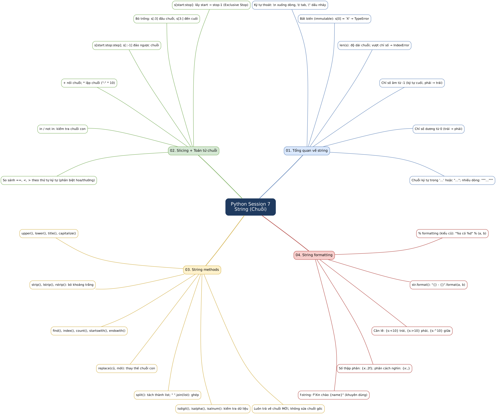

# Mindmap Python Session 7 - String

Sơ đồ tư duy tổng hợp kiến thức Session 7 của khóa Python về **chuỗi (string)**: tổng quan và chỉ số, cắt chuỗi (slicing) và toán tử chuỗi, các phương thức xử lý chuỗi và định dạng chuỗi.

🔗 **Link mindmap (draw.io):** [Mở mindmap trên draw.io](https://www.draw.io/#R3Zztb6M2HMf%2FGqTcpKuwjXl4GdJ2mraTJvWk3bsTISSwEmA8tM3%2B%2BvmR8OAs3Qo%2BkVN1xcaG1P74l6%2B%2FNhhoc3zbJ2lkoAcDbXZJcCiDowHNLDiSvHsDwi9JtjsGBTniZY5vP5dBEX%2FJd1HKc8o8r%2BW5TZSmpHqy45VNWg0%2BXjgL2FmzCMooq99Tgd2J1XkJ0kZ8wN9PdZxnJO8pqqqEHTkGtFNyRX9bkqMDPXqqyyQ7kHOrTdwYD8DwfcNzkk%2F8clV9SiN5jybbRfSGgFR7jZM6eiqCkJ59JX84yYvrYypOk6ZLN3mal6wuAnsU4D3Nz7O6k79n%2F0h%2BVZf5c3SpxlPyN70NaQSRFp%2BK3kn82VFZR28XWw90eynKj1FdnkgRUcGzRZUTT7sW5unXZFfHPA9Ci%2BfFUXKIxWUdyPOCiqcP7aXPfUUORHepuy41Rx1ngjuS8VV2Bmbd81cT0B58EbkuYL3D%2B27CntoFkbsPVT1ih260HfQIwPP0CICg3yU2ROMuMe1xlyD7410SyT7ptGmU7dZlmb%2BSVJZnJNMPm%2FKlbeTLrcXP%2FCE%2BNmrbJ9odon9vHXL%2FvCnDaDjE66A8RHWXnnE7llEa1MlL%2Fw4fw%2FT7GNRexCCnno0NMvx7%2BhlFvk8xJS3AECYhh7TMG3RII9zd3XWTtBdzVmdt%2BE7IC%2F%2FV0PgpiooEL5vFSTsOGpLesRtDche07tVVHfWvpzyacEBdDnHKAYUmGkCO5fUGkIPN0QBCDp5tAH2fbQjB%2Fz2E5LDuD6DvGocQUAwhCbJHP60cToBDbRu%2BSf9fAzaA5Kha0zFg0u%2FsuqTkrwEdfcYDNFzb8FhLxGIwrdHEX%2BU%2Fimcb9XjGaMwzlHlz8AwWwzPQxzP8LzwzUuFxyPFnem514asjbL9gKOKbAdkD6NvBcBPE20LzS%2BIRUkgg152PeLgY4qE%2B4tGI%2BDTKVtUnITw2FmVdIOtJZbI2KaphTy0xHfMiQrwYDqhmxS6PoA7svxCe3x5Ib5S3ALtlwR7sQE6tunJFNQWbCna0GNiRPtitEey%2BDL6YorpNpGR%2FpHPTVXI8NnWwTSMxHCoDE7gxjeqsem8G8G2g%2F7twfz0V0c2wDZ3%2BXBZ7CrThfGhbi0Hb0oc2HqH964XJK5mXMlVRixCPN5T1t7MwYdL8PANlKoWUqtnft23T3fklKS7HUcOms%2FwWp1vA3ZSzylPXuezRjmYM5HgxtGNdtI9nnSakDuNTmoSJcGYolF8F6VlXot%2BPlMukdiOO3J2l6gUXbpFt67EbHWBfdxvhbFL741PLtrFmdhu1TS2Bwm2kaqIiH4cG4qrOCyosWEhO22B6Ys1Ii%2FT1BC3O55kPb2HaVPSzEv5Jrq6pohLniUKug9C1iGvNFnHBBE7fBXw%2FEHGBCl59Th9QOH2%2BnNY9cquiIx9asUyOkNDL55kkAdtpxlF4I%2BogWn1ch0vyvn%2ByeNKx7V6T0tBD86EOFoO6xkgNr0dq%2BiviAds%2Fo05%2BSFBW4I5yKooPA3MknFWJ%2FBigkfcO38OckWi4GKKhPqLHJh8XyFk3mKr8vJ86asR3ijGw5uo8DfzcmxHSqsC8BTkCsXvduLbmU9MTeHm6mEb6mB57eUnGZn5UjmRU7ZskgymR53ZxHbHVmjJQgBzSDUWLZxVg5%2FqyIpxRPFuLYdXSx%2BrYnHvKmWzg9kQs%2FGR6ZsNd5ZRHUZE6iJhax1HOfkkN4Q3dvQvLjquCO3IwO7vcZDg4NdunQobDI7lmV51499nhFmK3eXXTiAXN%2BUYDXsxo0GbejdW1iZh5J%2FdtkkvG%2Ba6aGj4YKncB7uytjXXZcm4fRwAUSgLI1ZXpefy4Nm5ba2ZfTps2hgpfrimKqFx94tE3zV%2FPiTqp00gmwqBI6iAlyKx0RUolrBNFygGbnuOMhYM9W6iEE7huF%2BD8QKiEKjT1uW5Q4brRLdJFC2cvVcoUE73brj333G5GXSO%2B866U6ceJN1z%2FGHoBRIPQ6in49eYLrRNYabr4Bfr4HX%2FZ78lTJhLYhG75acMpYa6WCWa2Va9JHcsc0phtevG0kv1BfVqRhxSrys58tMLF0KpRCoxtsjIqUkLSKjQ2mM22KIpHOUfyExFr6zg4nedldK3ihxoMc6JrmX0zDGBsjQOtM6NQQItBF%2BlDd%2ByGVUWa1FIM1NxpCGNOKdvCyWyHNKmEt9AzbzsPl%2FyZJ9mKFhOXOvDqXnEDMGNnMCGz5XpcTzXY88FsLQZmSx%2FMY7ssqXbJIWnlQVIFaREH3WTWHCXsSrt3Jy2zR0Z964A1N4CxY7nDRTdHsSXTmw9jvBiM9flc3%2B0Rxr81zJ61st4MDA0fgx0qhy8ytf6FA%2F8ci%2BscOjvq1%2FeqZY1Du8QX3sI0z3Ss96A%2Bo%2FywF4O6rQv1sW42rZ6lu8%2FLY1DXUz%2FbvXfDSO3qbl1sYVPXs9144D2YzniZAbizPZv6cUHcNtfMtq42QYwUtu7%2Bs3i9ABMJ%2B7PE%2FcYWjkMhi%2BkCm%2BH47L0Yzn1PFa%2Be4%2BbESq2zdou8p2%2BhTEn1dE91wOtaGIH5KJ7AAb7A8QciK1JRrM8BRgoH%2BKn7BF1rOazvC%2F4wqVjm5c92OD7p3vUd3FOUGcPdheCwMyvMxLxu069K9YZzfwt8W%2BgdxgVCYD6%2BwWL4Bvr4VjxxTfdOuihrt54xVSyhrNgR3x8BTMam2XlpwKZX6tAt1X%2FQulsQP8gyh6SdJga3AD12nXcYzXjGoA4XAz3UBz1SLevdcZUsXYyO8nB8TudnzmxPlshaAUd6exNapN2n86%2BreXNiixaDrUZNbSm2EePB9I6I5LP91nCRQZdOxlRDXEkN4iN2Cu8GJjS9%2BI2R7bhXt1kg4M4HtrUYsGcynEny%2FB5Ddm74mkOSKd%2BPeC4k3p34Dw%3D%3D)



## Tóm tắt kiến thức

### Lesson 01: Tổng quan về string

- Chuỗi là dãy ký tự đặt trong `'...'` hoặc `"..."`; chuỗi nhiều dòng dùng `"""..."""`.
- **Chỉ số dương** bắt đầu từ `0` (trái → phải); **chỉ số âm** bắt đầu từ `-1` (ký tự cuối, phải → trái).
- `len(s)` trả về độ dài chuỗi; truy cập chỉ số vượt phạm vi sẽ báo `IndexError`.
- Chuỗi là **bất biến (immutable)**: `s[0] = "J"` báo `TypeError`. Muốn đổi thì tạo chuỗi mới.
- Ký tự thoát: `\n` xuống dòng, `\t` tab, `\"` dấu nháy kép trong chuỗi.

| Ký tự | P | y | t | h | o | n |
|---|---|---|---|---|---|---|
| Chỉ số dương | 0 | 1 | 2 | 3 | 4 | 5 |
| Chỉ số âm | -6 | -5 | -4 | -3 | -2 | -1 |

```python
s = "Python"
print(s[0], s[-1], len(s))   # P n 6
```

### Lesson 02: Slicing + Toán tử chuỗi

**Slicing** `s[start:stop:step]`: lấy từ `start` đến `stop - 1`. Ký tự ở vị trí `stop` **không được lấy** (Exclusive Stop).

```python
sku = "SHP-LAPTOP-DELL-001"
print(sku[0:3])    # SHP       (chỉ số 0, 1, 2)
print(sku[4:10])   # LAPTOP
print(sku[:3])     # SHP       (bỏ trống start = từ đầu chuỗi)
print(sku[-3:])    # 001       (bỏ trống stop = đến cuối chuỗi)
print(sku[::-1])   # 100-LLED-POTPAL-PHS  (step = -1: đảo ngược)
```

**Toán tử chuỗi:**

| Toán tử | Ý nghĩa | Ví dụ | Kết quả |
|---|---|---|---|
| `+` | Nối chuỗi | `"Py" + "thon"` | `"Python"` |
| `*` | Lặp chuỗi (nhân với số nguyên) | `"-" * 10` | `"----------"` |
| `in` / `not in` | Kiểm tra chuỗi con | `"DELL" in sku` | `True` |
| `==`, `<`, `>` | So sánh theo thứ tự ký tự, phân biệt hoa/thường | `"Python" == "python"` | `False` |

### Lesson 03: String methods

| Nhóm | Phương thức | Ví dụ → Kết quả |
|---|---|---|
| Đổi hoa / thường | `upper()`, `lower()`, `title()`, `capitalize()` | `"Python".upper()` → `"PYTHON"` |
| Bỏ khoảng trắng | `strip()`, `lstrip()`, `rstrip()` | `"  an  ".strip()` → `"an"` |
| Tìm kiếm | `find()`, `index()`, `count()` | `sku.find("DELL")` → `11`; `sku.count("-")` → `3` |
| Kiểm tra đầu / cuối | `startswith()`, `endswith()` | `sku.startswith("SHP")` → `True` |
| Thay thế | `replace(cũ, mới)` | `sku.replace("DELL", "HP")` → `"SHP-LAPTOP-HP-001"` |
| Tách / ghép | `split()`, `join()` | `sku.split("-")` → `['SHP', 'LAPTOP', 'DELL', '001']` |
| Kiểm tra dữ liệu | `isdigit()`, `isalpha()`, `isalnum()` | `"2024".isdigit()` → `True` |

```python
name = "  nguyễn văn an  "
print(name.strip().title())              # Nguyễn Văn An
parts = "SHP-LAPTOP-DELL-001".split("-")
print("/".join(parts))                   # SHP/LAPTOP/DELL/001
```

> Do chuỗi là bất biến, **mọi phương thức đều trả về chuỗi mới**, chuỗi gốc giữ nguyên. Muốn lưu kết quả phải gán lại: `name = name.strip()`.

Khác biệt cần nhớ: `find()` trả về `-1` khi không tìm thấy, còn `index()` báo lỗi `ValueError`.

### Lesson 04: String formatting

**f-string** (khuyên dùng): đặt `f` trước chuỗi và biến trong `{}`.

| Định dạng | Ví dụ | Kết quả |
|---|---|---|
| Chèn biến | `f"Xin chào {name}"` | `Xin chào An` |
| Số thập phân | `f"{price:.2f}"` | `1250000.50` |
| Phân cách hàng nghìn | `f"{price:,.2f}"` | `1,250,000.50` |
| Căn trái / phải / giữa (độ rộng 10) | `f"[{s:<10}]"`, `f"[{s:>10}]"`, `f"[{s:^10}]"` | `[Laptop    ]`, `[    Laptop]`, `[  Laptop  ]` |

Các cách định dạng khác:

```python
print("{} - {}".format("Laptop", 5))          # Laptop - 5
print("%s có %d sản phẩm" % ("Laptop", 5))    # Laptop có 5 sản phẩm  (kiểu cũ)
```
